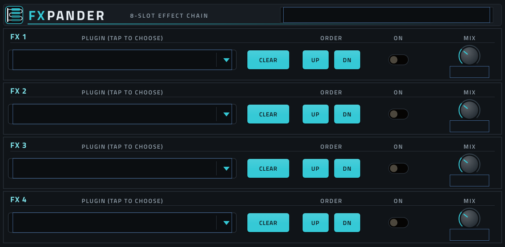
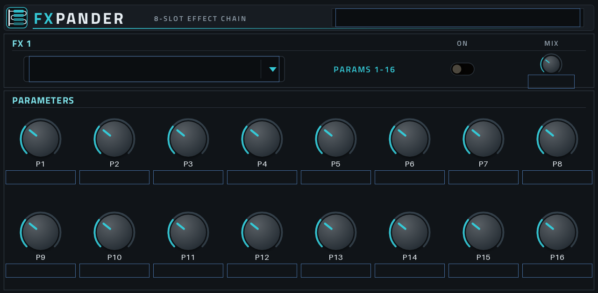
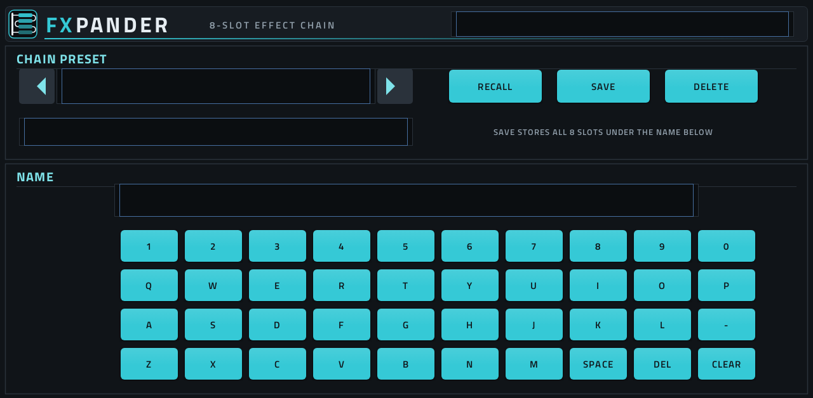

# FXpander

**An 8-slot effect chain for the Akai MPC, as one insert effect.**

MPC OS gives each channel four insert slots. FXpander is a VST2 effect that hosts other effects: put it in one insert
slot and chain up to eight of the effect plugins already installed on your MPC inside it. Each one has its own on/off,
dry/wet mix and all of its knobs. The chain saves with your project, and you can keep whole chains as presets.



## What it does

- **CHAIN page:** eight slots (FX 1-4 and FX 5-8). Tap a slot's field to pick a plugin from the list of effects your MPC
  knows about. CLEAR empties the slot, UP / DN move it in the chain, ON bypasses it, MIX blends dry and wet.
- **FX 1 … FX 8 pages:** the hosted effect's knobs, up to 64, on sub-pages of 16 ("FX 1: 1-16" … "FX 1: 49-64"), with
  its own names and value texts. They work with Q-Links and can be automated like any other plugin parameter.
- **PRESETS page:** 32 chain presets. Pick a slot, name it with the on-screen keyboard, SAVE / RECALL / DELETE.
  They are stored in `FXpander Presets/` on your MPC drive and also show up in MPC's own PRESET menu.
- **Saved with the project:** every slot's plugin, on/off, mix and full state, using the hosted plugin's own preset data
  where it has some. If a plugin is missing when a project loads, its slot keeps the saved state, so nothing is lost
  when you put the plugin back.




The screenshots are the skin as built; on the MPC the plugin names and values fill the outlined boxes.

**CPU:** a hosted effect costs what it costs on its own channel. Four typical effects run comfortably on an MPC One;
eight heavy ones can be more than one core can handle, so build big chains a plugin at a time and listen for dropouts.

## Requirements

- An MPC running MPC OS in standalone mode, with **root SSH access**. Installing a third-party plugin means copying it
  to the MPC's drive and adding it to MPC's plugin list (`MPC.settings`), and MPC OS has no menu for that.
  Tested on an MPC One.
- A computer with `ssh` and `scp` (Windows 10/11, macOS and Linux all have them).

## Install

1. Download `r5hfxpander.tar` and `register-fxpander.sh` from the [latest release](../../releases/latest).
2. Copy both to the MPC's `/tmp` (replace `MPC-IP` with your MPC's address):
   ```
   scp r5hfxpander.tar register-fxpander.sh root@MPC-IP:/tmp/
   ```
3. Run the installer:
   ```
   ssh root@MPC-IP sh /tmp/register-fxpander.sh
   ```
   It checks that the plugin's libraries resolve and that there is room, stops the MPC app, **backs up `MPC.settings`**
   to `settings-backups/` on the drive, adds FXpander's entry, unpacks the plugin into `Synths/` and starts the app
   again, so save your work first.

   It installs to the drive at `/media/MPC_ONE`. If yours has another name (`ls /media` on the MPC), add `DRIVE=`:
   ```
   ssh root@MPC-IP DRIVE=/media/MYDRIVE sh /tmp/register-fxpander.sh
   ```
4. FXpander is now in MPC's insert effect list (made by Ru5h).

FXpander lists the effects registered in `MPC.settings` (VST effects, not instruments, whose file exists). It doesn't
list itself.

### Updating

Copy the new `r5hfxpander.tar` and `update-fxpander.sh` to `/tmp` the same way and run
`ssh root@MPC-IP sh /tmp/update-fxpander.sh`. It swaps the plugin folder, keeping the old one as `fxpander-prev/` on the
drive, and restarts the app (MPC only reads a plugin's skin when it starts). Your chain presets aren't touched.

### Uninstalling

On the MPC: `systemctl stop acvs`, copy the backup from `settings-backups/` back over
`/data/Settings/MPC/MPC.settings` (or delete the `<PLUGIN ... uid="52354658" .../>` line from it), delete
`Synths/Ru5h - VST - FXpander/` from the drive, then `systemctl start acvs`. Projects saved with FXpander need it
installed again to play their chains.

## Building from source

Linux or WSL, with `python3` and Docker. The build runs in Docker images (an ARMv7 GCC for the MPC, plus the skin
renderer), so you don't need a cross compiler. Docker needs ARM emulation (`binfmt`/QEMU), which Docker Desktop
includes.

```
git clone --recursive https://github.com/djru5h/FXpander.git
cd FXpander
vst/build.sh       # the skin and vst/build/r5hfxpander.so
tools/pack.sh      # tools/r5hfxpander.tar, the folder the MPC expects
harness/run.sh     # offline checks under ASan/UBSan (x86 Docker)
```

The skin is built by [mpc-vst-plugins](https://github.com/sd88me/mpc-vst-plugins). Its scripts come in as a git
submodule (`mpc-vst-plugins/`, branch `ru5h-local`); set `MPC_VST=` to use another checkout. FXpander itself doesn't
link the framework's wrapper: `src/fxpander.c` is its own VST2 plugin on the MPC side and its own VST2 host on the
other.

| Path | What it is |
|---|---|
| `src/fxpander.c` | the whole plugin: the VST2 interface to MPC, hosting, the chain, presets, the plugin list |
| `vst/make_skin.py` | writes the parameter list and the touchscreen layout (`params.json`, `layout.conf`, art) |
| `vst/vst.json` | name, IDs and build settings for the framework's `gen_vst.py` |
| `harness/` | an x86 test host and test plugins (`run.sh`), and `devhost.c`, a test host that runs on the MPC |
| `tools/` | packing and the on-MPC install/update scripts |

The parameter order in `make_skin.py` is append-only: projects and automation store parameters by index.

## How it works

To MPC, FXpander is a stereo VST2 effect with 706 parameters. The CHAIN page's controls, a 64-knob pool per slot, the
preset controls and the picker list are all parameters. On the other side it loads each picked plugin with `dlopen`
and calls it as a VST2 host would, in series, with its own buffers, a click-free dry/wet mix and support for mono
effects. When a hosted plugin changes a value itself, FXpander passes that on to MPC under its own parameter number,
so MPC's display, Q-Links and automation follow it. Project state is one binary chunk ("FXP1") that holds each slot's
plugin ID and path, on/off, mix and the plugin's own chunk, or its parameter values if it has no chunk.

No Steinberg SDK code is used. The VST2 interface is written out in `src/fxpander.c`.

## License

MIT. See [LICENSE](LICENSE). VST is a trademark of Steinberg Media Technologies GmbH. MPC is a trademark of inMusic
Brands. This project is not affiliated with either.
